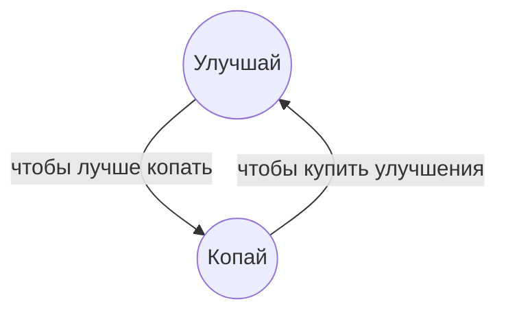

## Описание
Минималистичная игра о копании ямы в саду недавно приобретенного дома. Собирайте ресурсы, продавайте их, улучшайте свое оборудование и раскройте таинственную тайну. Стоит всего одну чашку кофе!
## Отзыв

<iframe src="https://clips.twitch.tv/embed?clip=EvilExpensiveRhinocerosTinyFace-gEruNy7_JZ6jqc-A&parent=mrlionalex.github.io" frameborder="0" allowfullscreen="true" scrolling="no" height="378" width="620"></iframe>

>[!quote] *Скуф долбит дыру...*

Теплое инди на один вечер - копай, продавай, улучшайся чтобы копать лучше и еще больше продавать, правда есть один моментик...

